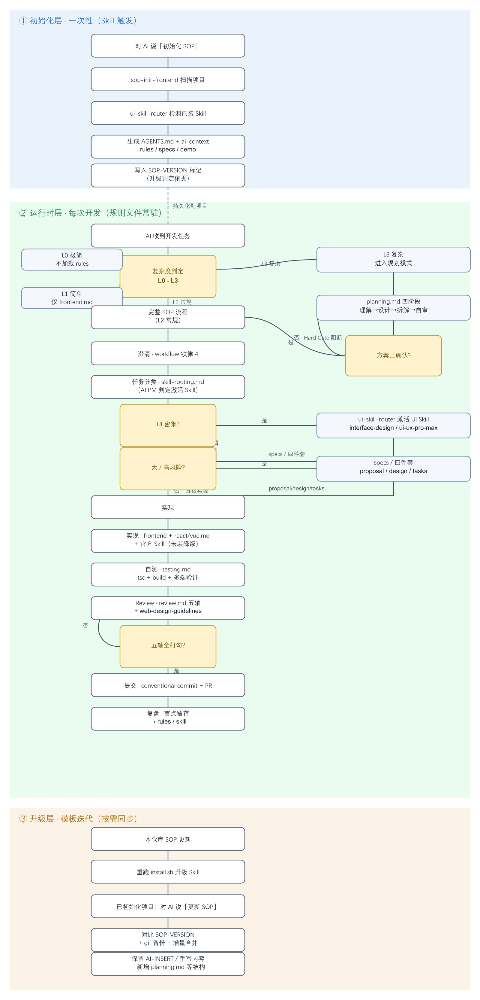

<!-- SOP-VERSION: 4.5 -->

# sop-frontend-kit — 前端项目 AI 协作脚手架（可插拔）

> **SOP 版本：v4.5**

一套**可复用的前端 AI 协作规范模板包**。放到任意前端项目中调用一次，AI 自动扫描项目结构并生成 `AGENTS.md` + `ai-context/` + `rules/` + `specs/`（+ 可选的 `demo/`）。支持 CodeBuddy / WorkBuddy 双工具。

---

## 安装（一键）

在仓库根目录执行：

```bash
bash scripts/install.sh          # Git Bash / Terminal
# Windows 也可直接运行（自动调用 Git Bash）：
scripts\install.bat
```

脚本会以**互动模式**运行，依次询问你：

1. **安装到哪个 AI 工具？** — WorkBuddy / CodeBuddy / 两者都装
2. **需要哪些框架 Skill？** — React 为主 / Vue 为主 / 两者都装 / 跳过

自有 Skill（始终安装）：

- `sop-init-frontend` — 提供「初始化 SOP」触发词
- `ui-skill-router` — UI / React / Vue Skill 调度器（AI PM）

推荐外部 Skill（按你的选择给出安装指令，**不自动执行**）：

| 你的选择 | 给出的指令 |
|---------|-----------|
| React 为主 | `npx skills add vercel-labs/agent-skills` |
| Vue 为主 | `npx skills add vuejs-ai/skills` |
| 两者都装 | 两条指令都给出 |
| 跳过 | 提示需要时再执行 |

> 非互动模式（CI）：`bash scripts/install.sh --all-react` / `--all-vue` / `--all`。
> 三个参数都会装到 **WorkBuddy + CodeBuddy 两个工具**（CI 里只装一半几乎总是意外）；只想装单个工具用 `bash scripts/install.sh workbuddy` 或 `codebuddy`（框架仍会询问）。`--help` 查看全部参数。
>
> Windows：cmd/PowerShell 直接 `scripts\install.bat`（自动调用 Git Bash）；或 Git Bash 中 `bash scripts/install.sh`。

<details>
<summary>手动安装 / 手动用模板（脚本不可用时的兜底）</summary>

**手动安装 Skill：**

```bash
# WorkBuddy — 仅自有 Skill
cp -r skills/sop-init-frontend ~/.workbuddy/skills/
cp -r skills/ui-skill-router ~/.workbuddy/skills/

# React 项目还需安装 Vercel 官方 Skill：
# npx skills add vercel-labs/agent-skills

# CodeBuddy（把 ~/.workbuddy 换成 ~/.codebuddy）
```

**完全不装 Skill、只用模板：** 复制 `skills/sop-init-frontend/templates/` 下模板，按 `{{占位符}}` 与 `<!-- AI-INSERT: xxx -->` 标记自行填充。

</details>

---

## 怎么用

1. 打开你的前端项目（React / Vue / Taro / Next.js … 均可）
2. 对 AI 说：**「初始化 SOP」** 或 **「建立 AI 协作规范」**
3. AI 先扫描项目结构（框架、路由、状态管理、样式、API 层等），出示结果让你确认
4. 确认后自动生成全套文件到项目内
5. 此后每次开发任务，AI 会自动判定复杂度（L0-L3），简单任务轻装上阵，复杂任务深度规划

---

## 上下文成本控制（token 预算）

规则越全，每次会话读入的上下文越多；而**上下文越长，关键约束反而越容易被稀释**。本 kit 用三层机制把成本压到可控：

| 机制 | 落在哪 | 作用 |
|------|--------|------|
| **三步判级 + 加载表** | `AGENTS.md` §一 | L0-L3 是 SOP 自定标签（工具不认识），所以判级写成可执行步骤：① 数改动面（≤1 / 1-2 / 3-5 / >5 文件）② 查高风险面（鉴权、支付、路由注册、全局状态等命中即 L3）③ 兜底默认 L2。判完在首条回复自报「判级 + 已读文件」，漏读一眼可见。纯样式改动只读 `frontend.md`「样式规范」+ `review.md`「五轴审查」+ `testing.md`「必过关卡」+ `workflow.md`「铁律 4」（合计约 3.4K 字符），不碰框架 rules / `planning.md` / `skill-routing.md` / `platform.md` |
| **读取纪律** | `AGENTS.md` §二 | 先 `grep -n "^## "` 取章节表，再按 `offset/limit` 读片段；同一会话不重读；`project-map` / `prd` / `design` 默认不读 |
| **体量预算** | `sop-check` | 每次运行打印 `AGENTS.md` / `rules` 实际字符数。`AGENTS.md` 用**分级阈值**：软基线 6,000（超了告警）/ 硬红线 12,000（超了 **FAIL**）；`rules/` 单文件 > 10,000、合计 > 40,000 告警 |

预算设的是**天花板**，不是目标。按模板生成一套 React 项目，`rules/` 开箱约 **34,000 字符**（`skill-routing.md` 9,600、`react.md` 8,100 是最大的两个），留给项目沉淀「已知陷阱」的空间约 6,000 字符——所以生成时应优先删掉与本项目无关的章节（另一个框架的适配说明、未安装 Skill 的详细用法），比事后拆分更有效。确需放宽时改 `sop.config.json`：

```json
{ "budgets": { "agentsMaxChars": 6000, "agentsHardMaxChars": 12000, "ruleMaxChars": 10000, "rulesTotalMaxChars": 40000 } }
```

#### 为什么 `AGENTS.md` 用分级阈值而不是一个硬数字

v3.8 最初设的是单一 4,500 字符阈值。在两个真实项目上实测发现它**指错了方向**：

| 项目 | 实际体量 | 与 `rules/` 的段落重复率 | 最大章占比 | 4500 阈值能说明什么 |
|------|---------|----------------------|-----------|-------------------|
| air-chat | 5,553 | **0%**（11 段中 0 段重复） | 23% | 什么都说明不了——只说「超了」 |
| ticket-auction | 10,814 | **0%**（22 段中 0 段重复） | 13% | 同上，且体积是阈值的 2.4 倍 |

两者的重复率都是 0%，说明体量来自**项目自身特有信息**（文件索引、仓库地图、红线、常用命令），不是把 `rules/` 抄了两遍。硬卡这个数只会把人推向两条坏路：改配置绕过，或把检查关掉——检查一旦失效，比没有检查更危险。

所以 v4.4 把它拆成三层：

| 层 | 阈值 | 行为 | 回答的问题 |
|---|------|------|-----------|
| **软基线** | 6,000 | WARN | 「是否仍是一份路由表」——超出但合理时，引导覆盖配置而不是删内容 |
| **硬红线** | 12,000 | **FAIL** | 「是否已失控」——~8,400 token 常驻上下文，此时「每次任务先读它」的纪律事实上失效 |
| **结构性检查** | 重复率 > 30% 或 ≥2 段重复<br>单章 > 800 字符且占比 > 50% | WARN | 「**到底该下沉什么**」——直接指出病根，而不是给一个无指向的总数 |

关键区别：前两层管「多大」，第三层管「**为什么大**」。只有第三层能区分「该下沉却没下沉」和「本项目信息量大」。

`"budgets": false` 关闭预算告警（体量指标仍会打印）。`--json` 输出的 `metrics` 字段（新增 `agentsDupRate`、`agentsMaxSectionRatio`）可直接接 CI 趋势图。

---

## 升级已初始化的项目

模板迭代后，升级分**两个独立步骤**——先升级 kit 自身的版本，再把新版本内容同步到各个项目：

### 第一步：升级 SOP 版本（kit 侧，一次性）

把本仓库更新到最新版（拉取最新代码），然后重跑安装脚本，让 Skill 升级到新版（所有项目通用）：

```bash
git pull                    # 更新 kit 到最新版
./scripts/install.sh        # 或 all —— 升级 Skill
```

> Skill 是用户级安装的（不在项目内），所以升级一次，所有项目立即用上新 Skill。

### 第二步：把新版内容同步到项目（项目侧，逐个项目）

在**每个已初始化的项目**里对 AI 说 **「更新 SOP」** 或 **「同步最新规范」**，AI 会：

1. 读取项目 `AGENTS.md` 顶部的 `SOP-KIT-REPO` / `SOP-KIT-COMMIT`，用 `git ls-remote` 取远端分支最新 sha 并比对；相同则提示「已是最新」
2. **增量合并**——保留你已填充的内容（AI-INSERT 区域、已知陷阱、用户约束、手写章节），只新增/更新模板结构变化
3. 新增旧版本没有的文件（如 v3.7 新增的 `quality-baseline.md`；`sop.config.json` 会询问是否启用代码熵检查）
4. 若新增了 `quality-baseline.md`，实跑命令采一次质量基线填入（跑不出填「未采集」）
5. 脚本类文件（`scripts/sop-check.mjs`）以 kit 最新版**整体覆盖**，并更新 `AGENTS.md` 的版本标记与导航
6. 输出变更报告，并跑一次 `node scripts/sop-check.mjs` 确认升级后健康

> 不会直接覆盖项目内容。遇到无法安全合并的冲突会停下来询问你如何处理。

**升级后的提交由你决定**：确认变更报告无误后，在**项目仓库**里自行提交一次 commit（如 `chore: 更新 SOP 至 vX.Y`）。这个 commit 就是回退点——kit 不代你提交，也不做自动 git 备份。

每个生成的项目 `AGENTS.md` 顶部都有 `<!-- SOP-VERSION: x.y -->` 与 `<!-- SOP-KIT-COMMIT: <sha> -->`，这是判断「是否需要升级、是否已是最新」的依据。

### 未安装 Skill 也能升级 ★

第二步**不依赖第一步**。只要 kit 仓库可达，AI 能自行取得模板与官方脚本完成升级——所以同事的机器、CI 环境、或只 clone 了项目代码的情况都能用：

```bash
git clone --depth 1 https://github.com/caidix/fe-sop-kit.git <临时目录>
```

> 临时目录放在**项目内** `.workbuddy/` 下（不写系统目录，避免权限与沙箱问题）；网络不稳定时最多重试 3 次。

每个已初始化项目的 `ai-context/sop-upgrade.md` 里已经写明了完整流程（版本检测 → 取 kit 模板与脚本 → 增量合并 → 网络不可达时降级），**AI 只需读这一个文件**。该文件由 kit 模板生成，随项目入库。

> ⚠️ **模板与官方脚本必须取自 kit 仓库，禁止手写替代实现**——手写版曾让 ignore 规则与扩展名表全部失效，检查静默失效却看起来「有门禁」。

### 版本检测：为什么比对 commit 而不是版本号

同一版本号内发生模板修补很常见，只比版本号会漏检——那正是「项目脚本停留在旧版、文档宣称的检查能力与实际脱节」的来源。

`sop-check` 已内置该检测，每次运行都会打印 kit 远端状态：

```
kit 远端：远端 3a239cc｜本地 3a239cc｜已是最新
kit 远端：远端 a1b2c3d｜本地 3a239cc｜有更新      ← 会同时产生一条 WARN
```

- 检测走 `git ls-remote`（一次请求，不 clone），8 秒超时、失败自动重试一次
- **网络不可达 / 无 git → 静默降级**，显示「远端未检测到」，绝不阻断检查（离线 CI 也能跑）
- 不想联网检测：`sop.config.json` 里设 `"kit": { "checkRemote": false }`

---

## SOP 健康检查 / CI 硬门禁 ★

初始化后的项目自带 `scripts/sop-check.mjs`（零依赖 Node 脚本），把软纪律变成可执行、CI 可阻断的硬约束（移植自 harness-engineering「验证优于说教」）：

> **脚本源在 Skill 目录内**：`skills/sop-init-frontend/scripts/sop-check.mjs`。它随 `install.sh` 一起分发到 `~/.workbuddy/skills/`（及 `~/.codebuddy/skills/`），「初始化 SOP」时从 Skill 目录整体复制到项目的 `scripts/`。
> **绝不要手写简化版替代**——曾有项目因找不到官方脚本而手写 151 行实现，其 ignore 规则与扩展名表全是坏的，两处检查静默失效却看起来「有门禁」。项目脚本若缺少 `SOP-CHECK-VERSION` 头，即为手写版，须整体覆盖。

```bash
node scripts/sop-check.mjs            # 检查（WARN 不阻断）
node scripts/sop-check.mjs --strict   # CI 用：警告也计为失败
node scripts/sop-check.mjs --json     # 机器可读输出
node scripts/sop-check.mjs --metric bundleSizeKb=262 [--metric coveragePct=58] [--note "v1.2 发版"]
                                       # 回归红线比对：与 sop.config.json 的 regressionGuards
                                       # 阈值比对，超线即失败；快照存 ai-context/quality-metrics.json
```

| 级别 | 检查项 |
|------|--------|
| **FAIL** | AGENTS.md / SOP-VERSION 标记缺失、必要 rules 缺失、仍有未填占位符 `{{...}}` |
| **WARN** | 版本漂移（含脚本版本落后提示）、**kit 远端有新版本（比对 commit，非版本号）**、TODO/TBD/待定残留（排除否定语境与代码块）、rules 文件 > 400 行、跨文件重复段落、frontend.md 缺 NFR 节、specs 四件套不齐备（`状态：草稿` 豁免，`specs/archive/` 跳过）、spec 状态缺失或不在枚举、已交付 > 90 天未归档、草稿停滞 > 30 天、活跃 spec > 8 个、缺质量基线快照（在 AGENTS.md「裁剪」区块显式声明不生成可豁免）、缺 `design-tokens.md`（可声明豁免）、未接入任何机器强制层（可声明豁免） |
| **WARN（预算）** | 规则体量超预算——`AGENTS.md` > 6,000 字符（软基线）/ `rules/` 单文件 > 10,000 / `rules/` 合计 > 40,000；另有两项结构性检查定位「该下沉什么」：`AGENTS.md` 与 `rules/` 段落重复率、单章占比（`sop.config.json` 的 `budgets` 可调，含 `agentsHardMaxChars` 硬红线；`false` 只关体量预算，>400 行检查仍执行）；每次运行都打印实际体量与重复率 |
| **WARN（可选）** | 代码熵扫描——**仅当 `sop.config.json` 里出现代码扫描字段（`srcDirs` / `checks` / `maxFileLines` 等，或显式 `"codeEntropy": true`）才启用**；只写 `budgets` 调预算不会触发扫描。检查超长源码 / console 残留 / any 类型 / 危险 API / 代码 TODO，各项可配阈值与忽略规则；**启用但未匹配到源文件会告警**（避免 srcDirs 写错时空跑）；无配置文件则完全静默 |
| **WARN（回归红线）** | `regressionGuards` 已配置阈值但从未用 `--metric` 采集过指标（缺 `ai-context/quality-metrics.json`）——配置了却从不采值的红线比不配置更具误导性 |
| **WARN（可选·色值）** | 硬编码颜色——代码层匹配 Tailwind 任意值（`-[#hex]` / `-[rgb()]`），样式层匹配原生 CSS 声明（`color: #fff;`）里的裸 hex/rgb/hsl。**样式层由 `styleExtensions` 控制**（默认 `.less/.css/.scss/.sass/.styl`），CSS 变量定义行与 `var(--token)` 引用不计入；token 真源文件须在 `colorAllowPatterns` 登记豁免 |

接入 CI（示例）：

```yaml
# .github/workflows/sop-check.yml
- run: node scripts/sop-check.mjs --strict
```

> kit 仓库自身也有自检：`node scripts/kit-self-check.mjs`（校验版本一致 / 模板齐全 / 占位符命名 / 废弃 skill 无残留），供 kit 维护者用。

---

## 生成的文件一览

```
<你的项目>/
├── AGENTS.md                          # 统一入口（CodeBuddy + WorkBuddy）+ SOP 版本标记
├── sop.config.json                    # 【可选，默认生成】代码熵硬门禁配置（sop-check 据此扫描源码）
├── ai-context/
│   ├── project-map.md                 # 目录地图 + **归属决策表** + 允许导入关系 + 项目地雷 ★
│   ├── prd.md                         # 产品定位 + 模块清单
│   ├── design.md                      # 架构设计 + 特有机制详解
│   ├── design-tokens.md               # 设计 token 清单 + **硬编码值三分类判定** ★（前端项目）
│   ├── sop-upgrade.md                 # **SOP 升级唯一流程** ★（版本检测 / 取 kit 模板与脚本 / 增量合并 / 降级）
│   ├── quality-baseline.md            # 质量基线快照（体积/覆盖率/tsc/lint + 回归红线）★
│   ├── release.md                     # 【可选，触发生成】发布前检查 + 回滚预案（发布动作归线上流水线，SOP 不接管）
│   ├── configs/                       # 【可选】机器强制层配置模板 ★
│   │   ├── README.md                  # 三件套分工 + 接入顺序（先定表 → 再翻译 → 先 warn → 转 error）
│   │   ├── eslint-boundaries.json     # 分层 import 边界（编辑器当场标红）
│   │   ├── dependency-cruiser.json    # 依赖图健康度（循环依赖 / 孤儿文件 / 跨 feature 引用）
│   │   ├── stylelint.json             # CSS 侧硬编码色值
│   │   └── ci-pipeline.yml            # CI 流水线骨架（lint/typecheck/test/build + audit + sop-check + 红线）★
│   └── rules/
│       ├── frontend.md                # 代码风格（必读）+ **硬编码值三分类** + 非功能需求(NFR)节 ★
│       ├── react.md                   # React 项目宪法 ★（第 0 节：代码风格；后续：Hooks/ErrorBoundary/Suspense 等）
│       ├── vue.md                     # Vue 专属约束 ★（仅 Vue 项目）
│       ├── platform.md                # 多端/多环境矩阵
│       ├── workflow.md                # 开发流程纪律 + 任务分类 + 任务闭环
│       ├── planning.md                # 复杂任务规划模式 ★（L3 四阶段：理解→设计→拆解→自审）
│       ├── testing.md                 # 验证基线 + TDD 工作流
│       ├── review.md                  # 五轴 Review 清单 + 可执行检查 + **设计一致性/落位正确性** ★
│       └── skill-routing.md           # Skill 调度规则（AI PM）★
├── specs/
│   ├── README.md                      # spec 说明 + 生命周期（活跃 / 归档 / 废弃）+ 触发判据
│   ├── TEMPLATE.md                    # 大需求四件套模板（含交付审计 + 交付结论）
│   ├── INDEX.md                       # 已归档 spec 索引（一行一个结论）★
│   └── archive/                       # 归档区（已交付 90 天 / 停滞草稿），检查器跳过
├── demo/                              # 【可选，默认不生成】好实践示例（阶段 1 确认需要才生成）
│   └── README.md                      # 实践沉淀默认走 rules「已知陷阱」节
└── scripts/
    └── sop-check.mjs                  # SOP 健康检查 / CI 硬门禁 ★
```

> `react.md` / `vue.md` 根据扫描到的框架**二选一**生成；`specs/` 默认生成空壳 + 说明，随项目发展填充；`demo/` v3.6 起改为**可选**（默认不生成——air-chat 等稳定项目实践证明示例库最终会被移除，实践沉淀走 rules「已知陷阱」更持久）。

---

## 功能流程图谱

本套 SOP 分三层协作：**初始化层**（一次性生成规则文件）、**运行时层**（每次开发自动生效）、**升级层**（模板迭代按需同步）。运行时入口先做复杂度判定（L0-L3），简单任务轻装、复杂任务深度规划。

```mermaid
flowchart TB
    %% ===== 层 1：初始化（Bootstrap）=====
    subgraph BOOT["① 初始化层 · 一次性（Skill 触发）"]
        direction TB
        A0["对 AI 说「初始化 SOP」"] --> A1["sop-init-frontend 扫描项目<br/>框架 · 路由 · 状态 · 样式 · API"]
        A1 --> A2["ui-skill-router 检测已装 Skill<br/>Vercel / Vue 官方 / UI ×4"]
        A2 --> A3["生成 AGENTS.md + ai-context/<br/>rules/ + specs/ + quality-baseline<br/>（demo/ 可选，默认不生成）"]
        A3 --> A4["写入 SOP-VERSION 标记<br/>（升级判定依据）"]
    end

    A4 -.持久化到项目.-> R0

    %% ===== 层 2：运行时（Runtime）=====
    subgraph RUN["② 运行时层 · 每次开发（规则文件常驻）"]
        direction TB
        R0["AI 收到开发任务"] --> R1{"复杂度判定<br/>L0 - L3"}
        R1 -->|"L0 极简"| L0["不加载 rules<br/>直接执行"]
        R1 -->|"L1 简单"| L1["样式规范 + review 五轴<br/>+ 必过关卡（约 3.4K 字符）"]
        R1 -->|"L2 常规"| PH2["完整 SOP 流程"]
        R1 -->|"L3 复杂 / 用户指定"| L3["进入规划模式"]

        L3 --> P1["planning.md 四阶段<br/>理解 → 设计 → 拆解 → 自审"]
        P1 --> HG{"方案已确认?"}
        HG -->|"否 · Hard Gate 阻断"| P1
        HG -->|"是"| PH2

        PH2 --> C1["澄清 · workflow 铁律4<br/>确认 新增/修改 + 落点"]
        C1 --> C2["任务分类 · skill-routing.md<br/>AI PM 判定激活 Skill"]
        C2 --> C3{"UI 密集?"}
        C3 -->|"是"| C4["ui-skill-router 激活<br/>interface-design / ui-ux-pro-max"]
        C3 -->|"否"| C5["纯框架 / 逻辑"]
        C4 --> C6{"大 / 高风险?"}
        C5 --> C6
        C6 -->|"是"| C7["specs/ 四件套<br/>proposal/design/tasks/acceptance"]
        C6 -->|"否"| C8["实现"]
        C7 --> C8
        C8 --> C9["实现 · frontend + react/vue.md<br/>+ Vercel/Vue 官方 Skill（未装降级）"]
        C9 --> C10["自测 · testing.md<br/>tsc + build + 多端"]
        C10 --> C11["Review · review.md 五轴<br/>+ web-design-guidelines / taste-skill"]
        C11 --> RG{"五轴全打勾?"}
        RG -->|"否"| C11
        RG -->|"是"| C12["提交 · conventional commit + PR"]
        C12 --> C13["复盘 · 盲点留存 → rules / skill"]
    end

    %% ===== 层 3：升级（Upgrade）=====
    subgraph UP["③ 升级层 · 模板迭代（按需同步）"]
        direction TB
        U1["第一步 · kit 侧：git pull 更新 SOP 版本<br/>重跑 install.sh 升级 Skill（所有项目通用）"]
        U1 --> U2["第二步 · 项目侧：对 AI 说「更新 SOP」<br/>比对远端 commit + 增量合并<br/>（未装 Skill 时 clone 自举）"]
        U2 --> U3["保留 AI-INSERT / 手写内容<br/>新增 quality-baseline.md 等结构<br/>整体覆盖 sop-check.mjs"]
        U3 --> U4["跑 sop-check 确认健康<br/>→ 用户在项目里自行 commit"]
    end
```



> 静态图片版（便于在不支持 Mermaid 渲染的预览中查看）：
>
> 
>
> *矢量源文件：[assets/functional-flow.svg](assets/functional-flow.svg)*

---

## 特色机制

- **设计 token 层 + 硬编码值三分类判定** ★（v4.0）：新增 `ai-context/design-tokens.md`——记录 token 真源、**语义命名体系**（`action-primary` 用途优先于 `blue-500` 外观）、**当前 token 清单**、**工具类映射覆盖度**，以及「硬编码值三分类」：**颜色字面量该禁 / token 引用合规 / 几何与变体合法**。判定依据是「这个值表达什么」，不是「它出现在哪种语法里」——Tailwind 把任意值定位为逃生舱，逃生舱本身合法，要约束的是「重复出现」而非「用了方括号」。同一色值出现 ≥2 次即为「该建 token」的信号。
- **机器强制层（configs/）** ★（v4.0）：把「什么放什么位置」「不许硬编码色值」从文档建议变成机器门禁——`eslint-boundaries.json`（分层 import 边界，编辑器当场标红）、`dependency-cruiser.json`（循环依赖 / 孤儿文件 / 跨 feature 引用）、`stylelint.json`（CSS 侧裸 hex）。**接入顺序有讲究**：先定归属决策表 → 再翻译成规则 → 先 warn 跑存量基线 → 最后转 error（直接开 error 会让项目立刻红掉，团队的反应通常是把规则关掉）。
- **归属决策表** ★（v4.0）：`project-map.md` 新增「什么东西放什么位置」对照表 + 「允许导入关系」越界表 + 「项目地雷」。针对 AI 生成代码最常见的错误——不是写错而是**放错**（工具函数塞进组件、请求逻辑写进 UI 层、类型定义各处重复）。
- **硬编码颜色扫描** ★（v4.0）：`sop-check` 新增代码熵检查项，识别 `-[#hex]` / `-[rgb()]` 形态并按色值聚合（`×4` 直接提示"该建 token"）。**刻意不用** `eslint-plugin-tailwindcss` 的 `no-arbitrary-value`——那条规则一刀切所有任意值，会误杀 token 引用与几何变体；误报率高的规则最终会被关掉，等于没有门禁。
- **硬门禁脚本（验证优于说教）** ★：`scripts/sop-check.mjs` 把"AGENTS.md 存在 / 占位符已填 / 版本一致"等软纪律变成 CI 可阻断的硬约束；`--strict` 模式警告也计失败。移植自 harness-engineering。
- **熵检测（entropy GC 窄版本）** ★：sop-check 自动检测 rules 超长（>400 行）、跨文件重复段落、TODO/TBD 残留、**规则体量预算**（AGENTS.md > 4,500 字符 / 单文件 > 10,000 / `rules/` 合计 > 40,000），每次运行都打印实际体量，防止 AI 生成的规则随时间臃肿。移植自 harness-engineering 的 entropy garbage collection。
- **非功能需求（NFR）承载** ★：`frontend.md` 新增「非功能需求」节——性能预算 / 安全基线 / 可访问性 / 浏览器兼容 / 国际化，作为可恢复、可校验的项目级约束。移植自 harness-engineering。
- **累积一致性** ★：复盘时踩过的坑不只写散文，而是沉淀为 `review.md` 可勾选检查项或 `sop-check` 检测规则，让一次踩坑变成后续所有任务的自动约束。移植自 harness-engineering。
- **加载成本分级（L0-L3）** ★：每次任务自动判定复杂度，并按「必读 / 按需 / 跳过」矩阵加载——L0 不读任何 rules、L1 只读「样式规范 + review 五轴 + 必过关卡 + 铁律 4」（约 3.4K 字符）、L2 读规则集（除 planning）、L3 全量 + 深度规划模式。配合**读取纪律**（先 `grep` 章节再按片段读、同一会话不重读、项目文档默认不读），避免把整套 rules 整文件反复读入。简单任务不为不需要的约束买单。
- **复杂任务规划模式** ★：L3 任务触发四阶段规划（理解需求 → 方案设计 → 任务拆解 → 自审），方案确认前**不写任何代码**。融合 ECC `planner.md` 的结构化方案 + Superpowers 的苏格拉底式提问 + bite-sized 任务粒度（2-5 分钟/task）。
- **全生命周期闭环**：复杂度预检 → 澄清 → 任务分类 + Skill 调度 → **规划（L3）** → UI 设计 → spec → 实现 → 自测 → Review → 提交 → 复盘，十一个阶段。
- **TDD 引导** ★：L3 复杂任务强烈建议采用 RED-GREEN-REFACTOR 循环；Bug 修复建议先写复现测试。灵感来自 Superpowers `test-driven-development`。
- **验证前置** ★：禁止未验证就声称完成——必须实际跑过类型检查 + 构建 + 多端验证后才算完成。灵感来自 Superpowers `verification-before-completion`。
- **Spec 自审清单** ★：spec 写好后的 Placeholder 扫描 / 一致性检查 / 范围检查 / 歧义检查，防止 TBD/TODO 污染。灵感来自 Superpowers `writing-plans`。
- **Hard Gate 机制** ★：L3 任务方案确认前禁止写实现代码；Review 五轴全部打勾才能提交。灵感来自 Superpowers 的 HARD GATE 设计。
- **代码风格就地扫描** ★：`react.md`/`vue.md`/`framework-generic.md`/`frontend.md` 在初始化时从项目真实代码中采样 5-10 个文件，提取声明方式、导出模式、类型标注偏好等，**以项目实际写法为准**。样本不足时主动询问用户保留已有风格还是采用官方推荐。
- **用户口述约束注入** ★：初始化或更新 SOP 时主动询问「你是否有额外的代码约束想加入？」，用户口述后 AI 识别并写入对应规则文件（React → `react.md` 0.6 节、Vue → `vue.md` 0.6 节、通用 → `frontend.md`），无需用户手动改配置文件。
- **AI PM 决策层**：内置 `skill-routing.md`，根据任务特征信号自动判定激活哪个 Skill（Vercel 官方 Skill / UI Skill / 框架 Skill），未安装自动降级。
- **框架专属约束**：React 搭配 Vercel 官方 `react-best-practices`（40+ 性能规则）+ `composition-patterns`（组件设计）；Vue 搭配 Vue 官方 `vuejs-ai/skills`（8 个专用 Skill，覆盖最佳实践/路由/Pinia/Composables/测试/调试）；**其他前端框架（Svelte/Angular/Solid/Vanilla）与后端语言（Python/Go/Java/Rust/...）走 `framework-generic.md` 通用兜底**（第 0 节代码风格扫描 + 该栈官方最佳实践）。官方 Skill 未安装时自动降级，不阻塞开发。
- **Skill 调度器**：`ui-skill-router` 协调 15+ 个外部 Skill（Vercel 官方 3 个 + Vue 官方 8 个 + 用户级 UI 4 个）按生命周期接力，未安装时自动降级，不阻塞开发。
- **五轴 Review**：正确性 / 可读性 / 架构 / 安全 / 性能 + 前端专项 + UI 审美/系统化审计（Vercel web-design-guidelines 100+ 规则）。
- **盲点留存**：遇到非显而易见的坑，AI 主动问你是否记成项目规则或 Skill，避免下次再犯（支持写入框架专属陷阱节）。
- **平台自适应**：支持手写路由 / File-based Router / 编译期插件注入等不同路由模式。
- **双工具兼容**：生成的 `AGENTS.md` 与 `ai-context/` 同时被 CodeBuddy 和 WorkBuddy 读取，规则一致。
- **载入契约（重要）**：L0-L3 只是本 SOP 的自定义标签，**工具并不认识它们**——agent 是靠读 `AGENTS.md` 里的「三步判级法」自然语言执行的。所以这套规则生效的前提是 **`AGENTS.md` 进了模型上下文**：CodeBuddy / WorkBuddy 会按约定自动读取；若换用 Cursor / Copilot / Claude Code 等，需把它映射到各自的入口（`.cursor/rules`、`.github/copilot-instructions.md`、`CLAUDE.md` 软链），否则规则等于没装。
- **框架层可插拔兜底** ★：不再只认 React/Vue。检测到 Svelte/Angular/Solid/Vanilla 等**其他前端框架**，或 Python/Go/Java/Rust 等**后端语言**时，自动生成 `rules/framework-generic.md`（第 0 节代码风格扫描 + 通用工程纪律 + 该栈官方最佳实践）。React/Vue 仍走深度专用模板；其余一切走通用兜底，项目约定始终优先。

---

## 其他框架 / 非前端项目怎么办？

本 kit 命名带 "fe"（frontend），但**框架层从 v3.5 起可插拔**——它不会再因为"不是 React/Vue"就退化成只有通用规则。初始化时按以下分类决定生成什么：

| 项目类型 | 检测信号 | 生成的框架级 rules | 说明 |
|---------|---------|------------------|------|
| **React**（含 Next.js / Taro-React / Remix） | `package.json` 含 `react` | `react.md` + `frontend.md` | 深度专用模板 + Vercel 官方 Skill |
| **Vue**（含 Nuxt / Taro-Vue） | `package.json` 含 `vue` | `vue.md` + `frontend.md` | 深度专用模板 + Vue 官方 8 Skill |
| **其他前端框架** | 含 `svelte` / `angular` / `solid` / 纯 `vite`+`vanilla` | `framework-generic.md` + `frontend.md` | 通用兜底，第 2 节填入该框架官方最佳实践 |
| **后端 / 非前端语言** | 含 `go.mod` / `requirements.txt` / `Cargo.toml` / `pom.xml` / 纯后端 `package.json` | `framework-generic.md`（跳过 `frontend.md`） | 质量约束完全由 `framework-generic.md` 的 NFR 节承载 |
| **未知 / 空项目** | 无任何框架信号 | 仅通用 rules（workflow/planning/testing/review/skill-routing） | 用户指定框架后再补 `framework-generic.md` |

**关键机制**：`framework-generic.md` 复用与 `react.md`/`vue.md` **完全相同的「第 0 节代码风格扫描」**——从项目真实源码采样提取声明方式、文件组织、导入约定、命名格式，而非套用教科书。第 1 节是语言无关的通用工程纪律（错误处理/异步/测试/日志），第 2 节由 AI 依据检测到的技术栈填入该语言/框架的官方最佳实践与常见陷阱。

**对后端项目**：`frontend.md` 里"hooks 模式""UI 组件"等前端专属节不适用，因此不生成它；可访问性（NFR 第 3 项）标注「不适用」，其余性能/安全/兼容矩阵照常填写。

**没有预置官方 Skill 的框架**：Svelte/Angular 等没有像 Vercel/Vue 那样的官方 agent Skill 时，不阻塞开发——`skill-routing.md` 自动降级到 `framework-generic.md` 第 2 节 + 通用原则；若社区有对应 Skill，装到用户级后路由表会自动识别。

---

## 已知坑（务必先看）

- **本地记忆不进 git**：`AGENTS.md` / `ai-context/` / `specs/` / `demo/` 入库；`.workbuddy/`、`.codebuddy/`（含 `memery`）不入库，需在项目 `.gitignore` 忽略（生成阶段会自动追加这两行）。


---

<details>
<summary>版本历史（CHANGELOG）</summary>

- **v4.5（当前）**：**补齐「代码写完之后」的工程链路**（对标大厂研发流程审计结论：本 SOP 在约束 AI 写代码上已成熟，弱项是代码合入与发布侧）——① **回归红线机器化（P0）**：`quality-baseline.md` 的回归红线原先只是文档占位符，永远没人比对。现在 `sop.config.json` 新增 `regressionGuards` 配置节（`bundleSizeKb` 基线+涨幅 / `coveragePct` 下限 / `tscErrors` / `lintWarnings` 上限，null=仅记趋势），发版一条命令 `node scripts/sop-check.mjs --metric bundleSizeKb=262 --note "v1.2 发版"` 即完成「采集 → 比对 → 存快照」，超线退出码 1 可接 CI；快照与趋势存 `ai-context/quality-metrics.json`（最近 20 条，随仓库提交）。另加一条 WARN：**红线已配置却从未采值**——配置了但不采集的红线比不配置更具误导性（看起来有防线）；② **CI 流水线模板（P0）**：新增 `configs/ci-pipeline.yml.template`——lint / typecheck / test+coverage / build 四件套 + 依赖安全审计（`npm audit --audit-level=high`，先 `continue-on-error` 观察、清理存量后转阻断）+ `sop-check --strict` 硬门禁 + 红线比对步骤。项目已有 CI 则不新建，只建议补 sop-check 步骤；③ **依赖安全审计**：`review.md` 可执行检查表新增 `npm audit` 行，补齐 supply chain 检查缺口（原先安全轴只有 XSS/敏感信息四条）；④ **人工 review 关卡**：`workflow.md` 阶段 C 明确「AI 五轴自查不替代人工 review——PR 需至少一名成员 approve」，AI 的角色是把 PR 预备好（自查过、证据齐、diff 干净），不是替 reviewer 签字；⑤ `sop-upgrade.md` 增量合并表新增 `quality-metrics.json`（脚本写入的采集快照）**保留不动**、`regressionGuards` 阈值保留项目值不回填默认；⑥ `kit-self-check` 新增多项防回归断言（版本一致性 / CI 与 release 模板存在 / sop-check 实现 --metric / 读取 regressionGuards / 检测格式错误 / 模板四指标齐全 / 安装先删后装 / 禁止复合占位符 / 规则性占位符须有填写指导 / 发布分支触发词）；⑦ **全量审计后修掉的历史缺陷**：**安装残留**（`cp -R` 是合并复制，新版删除的旧文件会留在 `~/.workbuddy/skills/`，AI 可能读到已废弃模板——改为**先删后装**）；**`--all-react` 只装一个工具**（CI 里几乎总是意外，改为与 `--all` 一致装两个，单独装用 `workbuddy` / `codebuddy`）；**kit 命名三套并存**（`yh-sop-fe-kit` / `sop-frontend-kit` / `fe-sop-kit` → 统一为 `fe-sop-kit`）；**SKILL.md 复合占位符写法** `{{REGRESSION_GUARD_1/2}}`——`sop-check` 残留检测正则只认 `{{A-Z0-9_}}`，含 `/` 的写法**检不出来会静默漏填**，改为逐个写全；**76 处模板占位符在 SKILL.md 无填写指导**——规则性内容（必过关卡 / 高风险判据 / 落点决策树）会被填成空话，等于把「验证优于说教」关掉，现逐文件补齐填写方法并加「占位符清点」总则；**`{{KIT_VERSION}}` 指向了 AGENTS.md 里不存在的占位符**（会误导 AI 自造标记）；⑧ 修复两类红线静默失效——`regressionGuards` 值写成非对象（含内层阈值写成字符串）、`regressionGuards` 写成数组、`sop.config.json` 损坏时，红线本会不声不响地完全不比对，现在明确判失败并指出原因（「看起来有防线」比没有防线更危险），且 `--metric` 模式与普通模式的判定标准已统一（此前两处实现不一致，数组场景一处报错一处放行）；⑨ `kit-self-check` 新增防线：禁止复合占位符写法（FAIL，防止静默漏填）、规则性模板占位符缺填写指导（FAIL）；⑩ **发布/回滚改为「可触发能力分支」**——部署流水线与发布回滚通常由项目已有的线上 Jenkins 等承接，SOP **不接管、不强制、不在初始化生成**：新增可选模板 `ai-context/release.md`（发布前检查清单 + 回滚预案 + 与线上流水线的衔接声明），用户说「建立发布流程 / 生成发布预案」时才生成，没有它的项目零告警；`workflow.md` 新增「发布/回滚」分支节（默认边界到「合入主干 + 验证证据」；用户意图为发布/回滚时按预案核对——按意图判断而非字面命中，避免「发布这个组件」这类日常表述误触，**不替用户触发发布**）；CI 模板定位同步澄清为**质量门禁流水线**（不含部署/发布）。
- **v4.4**：**把「AGENTS.md 字符预算」从单一硬阈值改为分级 + 结构性双指标**——v3.8 设的单一 4,500 字符阈值在两个真实项目上实测**指错了方向**：air-chat 5,553 字符（22 段中与 `rules/` 重复 **0 段**）、ticket-auction 10,814 字符（18 段，重复 **0 段**），两者重复率都是 0%，说明体量来自**项目自身特有信息**（文件索引、仓库地图、红线、常用命令），不是把 `rules/` 抄了两遍。硬卡这个数只会把人推向两条坏路——改配置绕过、或把检查关掉；而检查一旦失效，比没有检查更危险。修法三层：① **分级阈值**——软基线 4,500 → **6,000**（WARN，超了引导覆盖配置而非删内容）、新增硬红线 **12,000**（**FAIL**，~8,400 token 常驻上下文时「每次任务先读它」的纪律事实上已失效）；② **新增结构性检查**（这才是能指出病根的部分）——`AGENTS.md` 与 `rules/` 的**段落重复率**（>30% 或 ≥2 段重复即告警）与**单章占比**（单章 >800 字符且占全文 >50% 即告警，直接指名是哪一章撑大的）；原先的跨文件重复段落检测**只比 `rules/` 内部**，恰恰漏掉了「AGENTS.md 把 rules 抄了一遍」这个最该发现的膨胀方式；③ **模板余量体检**——原模板 4,444/4,500（98.8%）意味着项目一填自己的文件索引就立刻告警，这是设计缺陷而非项目问题，改为「模板不得占用软基线 80% 以上」的自检断言。`kit-self-check` 新增 5 项防回归断言（必须有硬红线 / 必须算重复率 / 必须检测单章占比 / 模板余量 / 预算与脚本默认值一致）。实测 6 场景（含 2 个负例）：3 段抄 2 段 → 报重复率 100%；单章占 100% 且 1,592 字符 → 报单章占比；15,220 字符 → 硬红线 FAIL 且退出码 1；各章均衡 → 不告警；两个真实项目 → 重复率 0%、退出码 0、无误报。——v4.2 的 commit 比对写成「`sop.config.json` 的 `kit.commit` 优先，AGENTS.md 的 `SOP-KIT-COMMIT` 兜底」，**只读其中一处**。而 commit 在两处都会被声明（升级流程第 4 步要求两处都更新），一旦只改了一处——例如改了 AGENTS.md 却忘了 config——检测就会用 config 里的旧值比对，**显示「已是最新」而实际已过期**。这是刚消灭掉的「静默失效」的又一种形态：**漏报**比误报更危险，因为误报会让人去检查，漏报则让人以为一切正常。修法：两处声明**全部收集、逐个比对**，任一过期即报「有更新」，并在告警与输出行里**精确指出是哪一处过期**（`sop.config.json 3a239cc、AGENTS.md 3a239cc`）。同时新增「commit 记录无效」告警（写成 `unknown` 之类占位值时明确提示，而不是静默当成没记录）。`kit-self-check` 新增两项防回归断言（必须收集两处来源、必须逐个比对）。实测四态：AGENTS.md 旧/config 新 → 报有更新并指明 AGENTS.md；AGENTS.md 新/config 旧 → 报有更新并指明 config；两处都新 → 已是最新；两处都旧 → 报有更新并列出两处。
- **v4.3**：**修「远端版本检测漏报」**（源自 air-chat 试点实测）——v4.2 的 commit 比对写成「`sop.config.json` 的 `kit.commit` 优先，AGENTS.md 的 `SOP-KIT-COMMIT` 兜底」，**只读其中一处**。而 commit 在两处都会被声明（升级流程第 4 步要求两处都更新），一旦只改了一处——例如改了 AGENTS.md 却忘了 config——检测就会用 config 里的旧值比对，**显示「已是最新」而实际已过期**。这是刚消灭掉的「静默失效」的又一种形态：**漏报**比误报更危险，因为误报会让人去检查，漏报则让人以为一切正常。修法：两处声明**全部收集、逐个比对**，任一过期即报「有更新」，并在告警与输出行里**精确指出是哪一处过期**（`sop.config.json 3a239cc、AGENTS.md 3a239cc`）。同时新增「commit 记录无效」告警（写成 `unknown` 之类占位值时明确提示，而不是静默当成没记录）。`kit-self-check` 新增两项防回归断言（必须收集两处来源、必须逐个比对）。实测四态：AGENTS.md 旧/config 新 → 报有更新并指明 AGENTS.md；AGENTS.md 新/config 旧 → 报有更新并指明 config；两处都新 → 已是最新；两处都旧 → 报有更新并列出两处。
- **v4.2**：**让「更新 SOP」不再依赖本机装了 Skill**——升级流程原先只写在 `skills/sop-init-frontend/SKILL.md` 里，而那份文件**只存在于 Skill 安装目录**。没装 Skill 的用户（同事的机器、CI 环境、只 clone 了项目代码）手里根本没有升级流程，AI 无从知道去哪里取官方模板与脚本，转头就会自行手写替代实现——**这正是 v4.1 事故的同一个根因在升级链路上的复现**。修法四条：① **项目内自带升级流程**——新增模板 `ai-context/sop-upgrade.md`（随项目入库），内含「版本检测 → 取 kit 模板与官方脚本 → 增量合并 → 网络不可达时降级」完整流程，并**明令禁止手写替代实现**；AGENTS.md 顶部新增「十一、SOP 升级（AI 必读）」指路，AI 读到就知道该读哪；② **未装 Skill 时的自举路径**——`git clone --depth 1 <repo> <项目内临时目录>`（临时目录放项目内 `.workbuddy/`，不写系统目录；网络不稳定最多重试 3 次），从 `<临时目录>/skills/sop-init-frontend/` 取 `templates/` 与 `scripts/`；③ **版本检测从版本号升级为 commit 级**——新增 `AGENTS.md` 的 `SOP-KIT-REPO` / `SOP-KIT-COMMIT` 标记与 `sop.config.json` 的 `kit` 字段（repo / branch / version / commit / checkRemote），`sop-check` 用 `git ls-remote --heads` 取远端分支 sha 与本地记录的 commit 比对，有更新即告警。只比版本号会漏检「版本号未变但模板已改」——那正是「项目脚本停留在旧版、文档宣称能力与实际脱节」的来源。检测 8 秒超时、失败重试一次、**网络不可达则静默降级绝不阻断**（离线 CI 也能跑），可用 `"kit": { "checkRemote": false }` 关闭；④ **溯源信息自动写入**——`install.sh` 安装 Skill 时写 `kit-source.json`（version / commit / repo / installedAt），初始化时据此填入 AGENTS.md 的 `{{KIT_COMMIT}}`，杜绝编造 sha；`kit-self-check` 新增 8 项防回归断言（升级流程模板存在且含 clone 与禁手写、AGENTS.md 模板含两个溯源标记、config 模板含 kit 字段、sop-check 实现 ls-remote 且读标记、install.sh 写 kit-source.json）。
- **v4.1**：**修「门禁本身失效」的两类根因**（源自 ticket-auction 项目实测）——① **官方脚本随 Skill 分发（P0）**：`scripts/sop-check.mjs` 原先只在 kit 仓库根的 `scripts/` 下，而 `install.sh` 只复制 `skills/` 目录，导致**装到别人主机上的 Skill 里没有官方脚本**。AI 执行「初始化 SOP」时找不到它，于是自己手写了一份 151 行简化实现（文件头甚至写着「本 kit 未提供官方脚本」）——那份手写版的 ignore 规则用 `p.replace(/\*\*\//g,'') + rel.includes()`，**永远匹配不到真实路径**（`src/utils/bid.test.ts` 匹配 `*.test.*` 恒为 false），扩展名表也只有 ts/tsx/js/jsx，**样式文件完全不扫描**。两处检查全部静默失效，却看起来「有门禁」。修法：脚本 `git mv` 到 `skills/sop-init-frontend/scripts/`（Skill 自带，随安装分发到 `~/.workbuddy` 与 `~/.codebuddy`），SKILL.md 生成清单与升级流程改指该路径并**明令禁止手写替代实现**，`kit-self-check` 新增三项防回归校验（脚本必须在 Skill 目录 / SKILL.md 必须指向它 / install.sh 必须整目录复制）；② **新增样式层色值扫描**：`sop-check` 原来只匹配 Tailwind 任意值形态（`-[#hex]`），样式文件里的原生声明（`color: #fff;`）完全扫不到——而这恰恰是很多项目的色值漂移主战场（实测某项目样式层 35 处裸色值、代码层 0 处）。新增 `styleExtensions` 配置（默认 `.less/.css/.scss/.sass/.styl`）与独立的「样式层」告警桶，排除 CSS 变量定义行与 `var(--token)` 引用，token 真源文件走 `colorAllowPatterns` 豁免；③ 顺带修正 `SKILL.md` 阶段 0 的硬编码色值探测——明确要求样式文件单独统计。
- **v4.0**：**从「写更多文档」转向「补机器强制层」**（源自 air-chat 深度使用暴露的通用缺口）——① **新增 `ai-context/design-tokens.md` 模板**：记录 token 真源、**语义命名体系**（用途优先于外观）、**当前 token 清单**、**工具类映射覆盖度**，以及**硬编码值三分类判定**——颜色字面量该禁 / token 引用合规 / 几何与变体合法。判定依据是「这个值表达什么」而非「它出现在哪种语法里」：Tailwind 官方把任意值定位为 escape hatch，逃生舱本身合法，要约束的是「重复出现」而非「用了方括号」；一刀切禁任意值会把代码逼向 inline style，UI 一致性反而更差。同一色值出现 ≥2 次即「该建 token」信号；② **新增 `ai-context/configs/` 机器强制层模板**（eslint 边界 / dependency-cruiser / stylelint），附接入顺序：先定归属表 → 再翻译成规则 → **先 warn 跑存量基线** → 最后转 error（直接开 error 会让项目立刻红掉，团队通常直接把规则关掉）；③ **`sop-check` 新增三项**：硬编码颜色字面量扫描（只命中 `-[#hex]` / `-[rgb()]` 形态，按色值聚合；**刻意不用** `eslint-plugin-tailwindcss` 的 `no-arbitrary-value`——它会误杀 token 引用与几何变体）、缺 `design-tokens.md` 告警、未接入任何强制层告警；④ **`project-map.md` 新增归属决策表 + 允许导入关系（越界表）+ 项目地雷**，并确立收录标准：**只写 agent 无法从代码直接读出的信息**（读一遍代码就知道的东西每次会话都要付费且稀释真正重要的约定）；⑤ **`frontend.md` 新增硬编码值判定 + 工具类映射要求**，`review.md` 新增「设计一致性」「落位正确性」两组检查项；⑥ `SKILL.md` 阶段 0 新增 token 层/硬编码现状/层级结构/现有强制层四项探测，阶段 1 新增两问（设计 token 体系、机器强制层），阶段 2 新增生成要求，升级流程明确 v4.0 新文件处理；⑦ `kit-self-check` 新增 v4.0 关键模板防误删校验。
- **v3.9**：**specs 生命周期（防止「永不清理」退化成垃圾场）**——① `specs/README` 模板确立三态（活跃 / 归档 / 废弃）与阈值：已交付满 90 天、草稿停滞 30 天、活跃目录 > 8 个即触发归档；② 归档落到 `specs/archive/`，检查器跳过该目录的四件套与占位符检查（冻结区不再当活跃 spec 管）；③ 新增 `specs/INDEX.md` 模板 + `proposal.md` 增加「交付结论」字段，归档时一句话登记，解决「查当初为什么这么做」；④ `sop-check` 新增五类 WARN：状态行缺失、状态值不在枚举、已交付超期未归档、草稿停滞、活跃超编（时间用文件 mtime 近似，新克隆不误报）；⑤ 归档前若代码注释引用了 spec 路径，README 约定先改为 `specs/archive/...` 或提交号。
- **v3.8**：**上下文成本控制（token 预算）**——① `AGENTS.md` 模板重构：把「进入项目后依次读取 11 个文件」改为「**三步判级法**（数改动面 → 查高风险面 → 兜底默认 L2）+ 加载表（必读 / 按需 / 跳过）+ 读取纪律（先 grep 章节再按片段读、不重读、项目文档默认不读）+ 文件索引表」，并在首条回复自报「判级 + 已读文件」，一次样式改动从「全量 rules（约 2.3 万字符）」降到「样式规范 + review 五轴 + 必过关卡 + 铁律 4（约 3.4K 字符）」；② AGENTS.md 瘦身（模板 3,774 字符，含三步判级法，外部 Skill 安装建议归并到 `skill-routing.md`，分级细则归位 `workflow.md`，删除与 rules 重复的说明）；③ 各 rules 模板加一行「职责 + 按节读」提示（不展开静态目录——目录用 `grep "^## "` 动态获取，避免漂移）；④ `sop-check` 新增**规则体量预算**（AGENTS.md 4,500 / 单文件 10,000 / 合计 40,000 字符，可由 `sop.config.json` 的 `budgets` 覆盖；`false` 只关体量预算，>400 行检查仍执行），每次运行打印实际体量，`--json` 输出 `metrics` 便于 CI 追踪；⑤ 修复 `workflow.md` 中 `demo/` 硬编码残留（改为条件化表述）；⑥ 判级可执行化（二次评审）：**L0-L3 是自定标签、工具不认识**，原「信号」列是模糊描述（多文件/正常功能），改为**三步判级法**——数改动面（≤1/1-2/3-5/>5 文件）→ 查高风险面（鉴权/支付/请求拦截器/构建配置/接口协议等命中即 L3，新增一条路由不算）→ 兜底默认 L2，并要求首条回复自报「判级 + 已读文件」以便核查；⑦ 二次评审修复：**质量基线豁免被文件索引行误触发**（改为只认「裁剪」区块的显式声明）、**代码熵启用但零匹配源文件时静默全绿**（现改为告警）、分级矩阵把 `review.md` / `testing.md` / `skill-routing.md` 降级为「按需」与各自的强制条款冲突（改为**必读、只读命中节**，不动质量红线），并把 `workflow.md` 铁律 4 的任务分类限定到 L2/L3；`kit-self-check` 的 install.sh 版本校验覆盖安装横幅、新增「生成集合计不得超预算」校验；代码熵改为「配置含代码扫描字段（或 `codeEntropy:true`）才启用」，避免只为调 `budgets` 的项目被意外开启扫描。
- **v3.7**：**把「验证优于说教」落到代码层 + 质量可度量**——① 新增可选 `sop.config.json`：项目放置后 `sop-check` 会扫描源码（超长文件 / console 残留 / any 类型 / 危险 API / 代码 TODO），按配置开关与阈值执行、每类输出限流；**不生成则代码熵检查完全静默**（老项目升级不会被刷屏）；② 新增 `ai-context/quality-baseline.md`：初始化时实跑命令采一次质量水位（bundle 体积/覆盖率/tsc/lint）+ 回归红线，作为改动前后对照基准；③ `frontend.md` 新增「设计决策卡」四问（状态放哪儿/组件怎么拆/副作用边界/请求竞态），把资深前端的取舍显式化，避免 AI 过度设计或漏掉竞态；④ 修 v3.6 Review 遗漏：install.sh 版本号、README/SKILL 中 demo/ 描述、spec 目录白名单过滤、TODO 否定语境改就近判定、spec 状态行必填强调。
- **v3.6**：**检查器自检与升级闭环修复**（源自 air-chat 实战评审）——① 修复 sop-check.mjs 全局正则 `lastIndex` 跨文件串扰（`todoRe` / `placeholderRe` 带 `/g` 在循环里 `.test()` 导致漏报/误报）；② TODO 检测排除否定语境与代码块（规则里「禁止：TBD」不再被误报为待办残留）；③ 新增 specs 四件套完整性检查（`状态：草稿` 豁免，残缺目录 WARN）；④ 脚本内嵌 `SOP-CHECK-VERSION` 标记并在输出打印，kit-self-check 校验其与 kit 版本一致，SKILL.md 增量更新流程明确「脚本类文件一律以 kit 最新版整体覆盖」（修复项目脚本停留在旧版、文档宣称能力与实际脱节的问题）；⑤ spec 状态机补「待验证」中间态 + 状态流转约定 + 「验证边界声明」节（部分完成的正式出口，防止状态与验证记录自相矛盾）；⑥ demo/ 改为可选（默认不生成），AGENTS.md 模板新增「本项目对 SOP 的裁剪」区块统一声明删减、升级时保留。
- **v3.5**：**框架层可插拔兜底**——不再只认 React/Vue。新增 `rules/framework-generic.md` 通用模板：第 0 节代码风格扫描（与 react.md/vue.md 同机制）+ 通用工程纪律 + 该栈官方最佳实践。初始化时按分类（React / Vue / 其他前端框架 / 后端语言 / 未知）决定生成哪个框架 rules；后端项目跳过 `frontend.md`，质量约束由 `framework-generic.md` NFR 节承载。`sop-check.mjs` 框架文件要求改为 react/vue/generic 至少其一，`frontend.md`/`platform.md` 降级为 WARN。
- **v3.4**：移植 harness-engineering 优点——新增 `scripts/sop-check.mjs` 硬门禁脚本（验证优于说教：占位符/版本/规则完整性 CI 可阻断）+ 熵检测（超长/重复/TODO）；新增 `scripts/kit-self-check.mjs`（kit 侧 evals）；`frontend.md` 新增「非功能需求 NFR」节（性能/安全/可访问/兼容/i18n 作为可恢复约束）；`review.md` 五轴增加可执行检查命令；复盘阶段增加「累积一致性」（坑沉淀为可勾选检查项/sop-check 规则）。
- **v3.3**：新增「复杂度分级 L0-L3」——简单任务轻装上阵、复杂任务深度武装；新增 L3 复杂任务规划模式 `planning.md`（融合 ECC `planner.md` 结构化方案 + Superpowers `brainstorming` 苏格拉底提问 + `writing-plans` bite-sized 任务粒度）；引入 TDD 引导、验证前置、Spec 自审清单、Hard Gate 机制。
- **v3.2**：接入 Vue 官方 `vuejs-ai/skills`（8 个专用 Skill）；`install.sh` 改为互动式（按 React/Vue 选择，仅给出安装指令不自动执行，避免替用户装无用 Skill）；废弃自有 `vue-best-practices`。
- **v3.0 / v3.1**：接入 Vercel 官方 `react-best-practices` / `composition-patterns` / `web-design-guidelines` 替代自有 React 约束；新增项目代码风格就地扫描（react.md/vue.md 第 0 节，以项目真实写法为准）；用户口述约束注入；样本不足时主动询问降级。
- **v1 / v2**：基础九阶段 SOP 生命周期；AI PM 决策层 `skill-routing.md`；UI Skill 路由（interface-design / ui-ux-pro-max / impeccable / taste-skill）。

</details>


